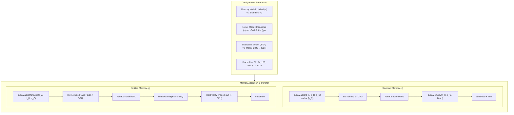
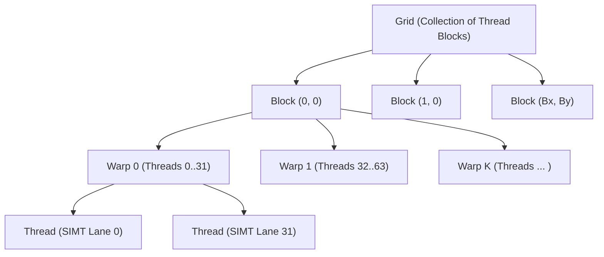
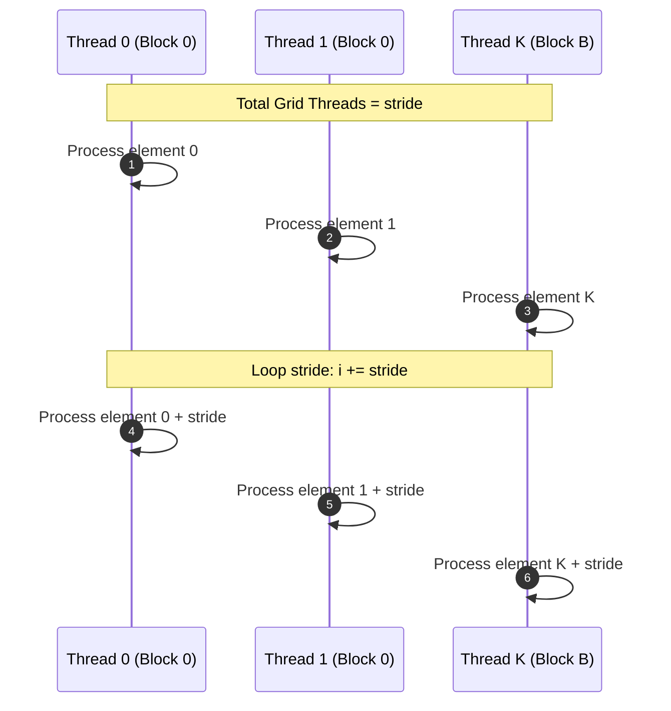

# Architecture and Implementation Guide: CUDA Vector & Matrix Applications

**Course:** Massively Parallel Programming on GPUs  
**Instructor:** Donato D'Ambrosio  
**Department:** Mathematics and Computer Science, University of Calabria  
**Subject:** Lab 1 — Unified vs. Standard Memory, Monolithic vs. Grid-Stride Kernels, Vector & Matrix Operations  

---

## Table of Contents
1. [Overview & System Architecture](#1-overview--system-architecture)
2. [GPU Execution & Thread Hierarchy](#2-gpu-execution--thread-hierarchy)
3. [Memory Models: Standard vs. Unified Memory](#3-memory-models-standard-vs-unified-memory)
4. [Kernel Execution Paradigms: Monolithic vs. Grid-Stride Loops](#4-kernel-execution-paradigms-monolithic-vs-grid-stride-loops)
5. [Detailed Code Walkthrough & Kernels](#5-detailed-code-walkthrough--kernels)
   - [5.1 Initialization Kernels](#51-initialization-kernels)
   - [5.2 Vector Addition Kernels](#52-vector-addition-kernels)
   - [5.3 Matrix Addition Kernels & 2D Coalescing](#53-matrix-addition-kernels--2d-coalescing)
   - [5.4 Grid & Block Dimension Computation](#54-grid--block-dimension-computation)
6. [High-Precision Instrumentation & Verification](#6-high-precision-instrumentation--verification)
   - [6.1 Error Handling (`CUDA_CHECK`)](#61-error-handling-cuda_check)
   - [6.2 CUDA Event Timers vs. Wall-Clock Timers](#62-cuda-event-timers-vs-wall-clock-timers)
   - [6.3 Verification Logic](#63-verification-logic)
7. [Compilation & Build System](#7-compilation--build-system)
8. [CLI Usage & Pure C/CUDA Testing Guide](#8-cli-usage--pure-ccuda-testing-guide)
   - [8.1 CLI Syntax & Options](#81-cli-syntax--options)
   - [8.2 Core Test Scenarios (Bash)](#82-core-test-scenarios-bash)
   - [8.3 Block Size Sweep Script (Bash)](#83-block-size-sweep-script-bash)
9. [GPU Profiling Guide (`nvprof` & `ncu`)](#9-gpu-profiling-guide-nvprof--ncu)
10. [Key Architectural Takeaways](#10-key-architectural-takeaways)

---

## 1. Overview & System Architecture

This project explores two fundamental dimensions of CUDA programming:
1. **Memory Management Strategy:**
   - **Standard Memory (`s`):** Explicit host memory (`malloc`), device memory (`cudaMalloc`), and manual PCIe data transfers (`cudaMemcpy`).
   - **Unified Memory (`u`):** Single pointer managed pool (`cudaMallocManaged`) accessed transparently across CPU and GPU via hardware-assisted page fault migration.
2. **Kernel Scheduling Model:**
   - **Monolithic Grid (`m`):** Direct 1-to-1 mapping where the total number of threads launched equals or exceeds the total number of data elements.
   - **Grid-Stride Loop (`gs`):** A fixed, hardware-scaled grid of threads where each thread loops over the dataset in strides of `gridDim * blockDim`.

These strategies are evaluated across two workloads using 64-bit double-precision floating-point numbers (`double`):
- **Vector Addition:** $N = 2^{24} = 16,777,216$ elements (128 MB per vector; total data: 384 MB for $A, B, C$).
- **Matrix Addition:** $2048 \times 4096 = 8,388,608$ elements in row-major layout (64 MB per matrix; total data: 192 MB for $A, B, C$).



---

## 2. GPU Execution & Thread Hierarchy

NVIDIA GPUs follow the **SIMT (Single Instruction, Multiple Threads)** execution model. The execution hierarchy is organized as follows:



### Key Hardware Concepts
1. **Streaming Multiprocessors (SMs):**
   - Independent compute engines containing CUDA cores, register files, warp schedulers, and shared memory / L1 caches.
   - For example, an NVIDIA RTX 4080 Laptop GPU has **58 SMs**, while a GTX 980 has **16 SMs**.
2. **Warps (The Unit of Scheduling):**
   - The basic execution unit is a **warp** of **32 parallel threads**.
   - All 32 threads in a warp execute the same instruction at the same cycle. Block sizes should always be multiples of 32 to avoid inactive SIMT lanes.
3. **Thread Blocks:**
   - A block executes entirely on a single SM and cannot migrate across SMs.
   - An SM can host multiple concurrent blocks subject to register and shared memory limits.
4. **Memory Coalescing:**
   - When the 32 threads in a warp access consecutive 64-bit words in global memory, the GPU memory controller merges these accesses into a single 128-byte transaction.
   - Non-contiguous or strided accesses cause transaction serialization and waste memory bandwidth.

---

## 3. Memory Models: Standard vs. Unified Memory

The implementation in [lab1.cu](file:///home/wip/parallel_programming_on_gpu/labs/lab1/lab1.cu) and [common.h](file:///home/wip/parallel_programming_on_gpu/labs/lab1/common.h) contrasts two memory management paradigms:

### 3.1 Standard Memory (`cudaMalloc` + `cudaMemcpy`)
- **Host and Device Memory are Completely Separate:**
  - `malloc()` allocates memory in host system RAM.
  - `cudaMalloc()` allocates memory in GPU device VRAM (GDDR6 / HBM).
- **GPU-Side Initialization:**
  - Notice that buffers $A$, $B$, and $C$ are initialized directly on the GPU using initialization kernels (`vectorInit` / `matrixInit`).
  - This avoids transferring $3 \times 128\text{ MB} = 384\text{ MB}$ over the slow PCIe bus during startup.
- **Explicit Result Transfer:**
  - Only the result buffer $C$ is copied back to host RAM via `cudaMemcpy(..., cudaMemcpyDeviceToHost)`.
  - The transfer time is directly measured via CUDA events (`memcpyTimeMs`).

```c
// Standard Memory Pattern
double *d_A, *d_B, *d_C;
double *h_C = (double*)malloc(bytes);

CUDA_CHECK(cudaMalloc((void**)&d_A, bytes));
CUDA_CHECK(cudaMalloc((void**)&d_B, bytes));
CUDA_CHECK(cudaMalloc((void**)&d_C, bytes));

// Init & compute directly on GPU...
vectorInit<<<gridDim, blockDim>>>(d_A, 1.0, n);
vectorInit<<<gridDim, blockDim>>>(d_B, 2.0, n);
vectorAdd<<<gridDim, blockDim>>>(d_A, d_B, d_C, n);

// Explicit Device-to-Host transfer
CUDA_CHECK(cudaMemcpy(h_C, d_C, bytes, cudaMemcpyDeviceToHost));

// Cleanup
free(h_C);
CUDA_CHECK(cudaFree(d_A));
CUDA_CHECK(cudaFree(d_B));
CUDA_CHECK(cudaFree(d_C));
```

### 3.2 Unified Memory (`cudaMallocManaged`)
- **Single Pointer Accessible Everywhere:**
  - Allocated with `cudaMallocManaged(&ptr, bytes)`.
  - The same pointer is valid in both host C code and device CUDA kernels.
- **On-Demand Page Faulting:**
  - Memory is not eagerly copied. Instead, the CUDA driver and GPU Memory Management Unit (MMU) migrate memory at 4 KB / 64 KB page granularity when a page fault occurs.
  - When the GPU first touches the pointer in `vectorInit`, pages fault and migrate to GPU VRAM.
  - When the CPU verifies results in `verify_vector(d_C, n, 3.0)`, pages fault and migrate across the PCIe bus back to host RAM.
- **Synchronization Required:**
  - Since kernel launches are asynchronous, the CPU must call `cudaDeviceSynchronize()` before touching managed memory.

```c
// Unified Memory Pattern
double *d_A, *d_B, *d_C;

CUDA_CHECK(cudaMallocManaged((void**)&d_A, bytes));
CUDA_CHECK(cudaMallocManaged((void**)&d_B, bytes));
CUDA_CHECK(cudaMallocManaged((void**)&d_C, bytes));

// Init & compute on GPU
vectorInit<<<gridDim, blockDim>>>(d_A, 1.0, n);
vectorInit<<<gridDim, blockDim>>>(d_B, 2.0, n);
vectorAdd<<<gridDim, blockDim>>>(d_A, d_B, d_C, n);

// CPU must wait before reading managed pointers
CUDA_CHECK(cudaDeviceSynchronize());

// Host directly reads d_C (triggers on-demand page migration)
verify_vector(d_C, n, 3.0);

CUDA_CHECK(cudaFree(d_A));
CUDA_CHECK(cudaFree(d_B));
CUDA_CHECK(cudaFree(d_C));
```

### Standard vs. Unified Comparison

| Feature | Standard Memory (`s`) | Unified Memory (`u`) |
| :--- | :--- | :--- |
| **Allocation API** | `malloc()` (host) + `cudaMalloc()` (device) | `cudaMallocManaged()` |
| **Pointers** | Separate host (`h_C`) and device (`d_C`) | Single unified pointer (`d_C`) |
| **Transfer Mechanism** | Explicit `cudaMemcpy()` | Driver page-fault migration engine |
| **Measured Memcpy Time** | Measured via CUDA events ($~24\text{--}28\text{ ms}$) | $0.000\text{ ms}$ (no explicit call) |
| **Total Wall-Clock Time** | Includes explicit `cudaMemcpy` | Includes on-demand PCIe page faults during CPU verification |

---

## 4. Kernel Execution Paradigms: Monolithic vs. Grid-Stride Loops

### 4.1 Monolithic Kernel Execution (1-to-1 Mapping)
In the monolithic pattern, the grid size is chosen such that every data element has a dedicated CUDA thread:
$$\text{numBlocks} = \left\lceil \frac{N}{\text{blockSize}} \right\rceil = \frac{N + \text{blockSize} - 1}{\text{blockSize}}$$

```c
__global__ void vectorAdd(const double *A, const double *B, double *C, size_t n) {
    size_t i = (size_t)blockIdx.x * blockDim.x + threadIdx.x;
    if (i < n) {
        C[i] = A[i] + B[i];
    }
}
```

#### Characteristics
- **Direct 1:1 Mapping:** Easy to reason about for simple algorithms.
- **Excessive Block Counts:** For $N = 2^{24}$ and block size $256$, the grid contains $65,536$ blocks. For block size $32$, the grid balloons to $524,288$ blocks!
- **Grid Limit Vulnerability:** If $N$ exceeds the maximum grid dimension ($2^{31}-1$ in $x$), the launch fails.
- **Hardware Agnostic:** Launches millions of blocks regardless of whether the GPU has 16 SMs or 128 SMs.

---

### 4.2 Grid-Stride Loop (GSL) Execution
The **Grid-Stride Loop** (introduced by Mark Harris, NVIDIA) decouples the grid dimensions from the input array size. Threads iterate through the array using a stride equal to the total number of threads in the entire grid:
$$\text{stride} = \text{gridDim.x} \times \text{blockDim.x}$$

```c
__global__ void vectorAddGSL(const double *A, const double *B, double *C, size_t n) {
    size_t tid = (size_t)blockIdx.x * blockDim.x + threadIdx.x;
    size_t stride = (size_t)blockDim.x * gridDim.x;

    for (size_t i = tid; i < n; i += stride) {
        C[i] = A[i] + B[i];
    }
}
```



#### Why Grid-Stride Loops Are Architecturally Superior:
1. **Hardware Scalability:**
   - The grid size is capped to saturate the GPU SMs (e.g., $32 \times \text{numSMs}$ blocks). On a 58-SM GPU, this creates $1,856$ blocks instead of $65,536$ or $524,288$ blocks.
2. **Thread and Register Reuse:**
   - Instead of destroying threads and scheduling new blocks, active threads loop in place. Registers and L1 cache lines are reused across loop iterations.
3. **Decoupled Sizing:**
   - The exact same kernel can process 100 elements or 10 billion elements without changing launch configuration or exceeding CUDA grid limits.
4. **Coalescing Preserved:**
   - Since `stride` is a multiple of `blockDim.x` (which is a multiple of warp size 32), adjacent threads always access adjacent elements across every loop iteration ($i, i+1, i+2, \dots$).

---

## 5. Detailed Code Walkthrough & Kernels

### 5.1 Initialization Kernels
All input data ($A$, $B$, $C$) is initialized directly on the GPU to avoid unneeded host-to-device transfers.

#### Monolithic Vector Initialization:
```c
__global__ void vectorInit(double *data, double val, size_t n) {
    size_t i = (size_t)blockIdx.x * blockDim.x + threadIdx.x;
    if (i < n) data[i] = val;
}
```

#### Grid-Stride Vector Initialization:
```c
__global__ void vectorInitGSL(double *data, double val, size_t n) {
    size_t tid = (size_t)blockIdx.x * blockDim.x + threadIdx.x;
    size_t stride = (size_t)blockDim.x * gridDim.x;
    for (size_t i = tid; i < n; i += stride) {
        data[i] = val;
    }
}
```

---

### 5.2 Vector Addition Kernels

In [lab1.cu](file:///home/wip/parallel_programming_on_gpu/labs/lab1/lab1.cu#L24-L62):
- Elements in $A$ are set to `1.0`.
- Elements in $B$ are set to `2.0`.
- Addition produces $C[i] = A[i] + B[i] = 3.0$.

#### Monolithic Vector Add:
```c
__global__ void vectorAdd(const double *A, const double *B, double *C, size_t n) {
    size_t i = (size_t)blockIdx.x * blockDim.x + threadIdx.x;
    if (i < n) C[i] = A[i] + B[i];
}
```

#### Grid-Stride Vector Add:
```c
__global__ void vectorAddGSL(const double *A, const double *B, double *C, size_t n) {
    size_t tid = (size_t)blockIdx.x * blockDim.x + threadIdx.x;
    size_t stride = (size_t)blockDim.x * gridDim.x;
    for (size_t i = tid; i < n; i += stride) {
        C[i] = A[i] + B[i];
    }
}
```

---

### 5.3 Matrix Addition Kernels & 2D Coalescing

In 2D matrix operations, memory layout is **row-major**: an element at `(row, col)` is located at linear index:
$$\text{idx} = \text{row} \times \text{ncols} + \text{col}$$

```
Row 0:  [ (0,0),  (0,1),  (0,2),  ...  (0, ncols-1) ]
Row 1:  [ (1,0),  (1,1),  (1,2),  ...  (1, ncols-1) ]
...
```

To ensure memory coalescing:
- Threads with consecutive `threadIdx.x` **must** map to consecutive `col` indices.
- When `threadIdx.x` increments by 1, $\text{idx}$ increments by 1, guaranteeing a single 128-byte coalesced memory transaction per warp!

#### Monolithic Matrix Kernel:
```c
__global__ void matrixAdd(const double *A, const double *B, double *C, 
                          size_t nrows, size_t ncols) {
    size_t col = (size_t)blockIdx.x * blockDim.x + threadIdx.x;
    size_t row = (size_t)blockIdx.y * blockDim.y + threadIdx.y;

    if (row < nrows && col < ncols) {
        size_t idx = row * ncols + col;
        C[idx] = A[idx] + B[idx];
    }
}
```

#### Grid-Stride Matrix Kernel:
In the 2D Grid-Stride loop, strides operate independently in the $x$ (columns) and $y$ (rows) dimensions:
```c
__global__ void matrixAddGSL(const double *A, const double *B, double *C, 
                             size_t nrows, size_t ncols) {
    size_t startCol = (size_t)blockIdx.x * blockDim.x + threadIdx.x;
    size_t strideCol = (size_t)blockDim.x * gridDim.x;
    size_t startRow = (size_t)blockIdx.y * blockDim.y + threadIdx.y;
    size_t strideRow = (size_t)blockDim.y * gridDim.y;

    for (size_t r = startRow; r < nrows; r += strideRow) {
        for (size_t c = startCol; c < ncols; c += strideCol) {
            size_t idx = r * ncols + c;
            C[idx] = A[idx] + B[idx];
        }
    }
}
```

---

### 5.4 Grid & Block Dimension Computation

The dimension calculation logic in [lab1.cu](file:///home/wip/parallel_programming_on_gpu/labs/lab1/lab1.cu#L94-L121) adapts based on the operation and execution model:

#### Vector Grid Calculation:
```c
static inline int calculate_vector_grid_size(size_t n, int blockSize, int numSMs, KernelModel model) {
    int neededBlocks = (int)((n + (size_t)blockSize - 1) / (size_t)blockSize);
    if (model == MODEL_GRID_STRIDE) {
        int smCount = (numSMs > 0) ? numSMs : 1;
        int maxBlocks = smCount * 32; // Scale grid to hardware SM capacity
        return (neededBlocks < maxBlocks) ? neededBlocks : maxBlocks;
    }
    return neededBlocks;
}
```

#### Matrix 2D Dimension Calculation:
For matrix operations, the block is structured as a 2D tile:
- $bx = 32$ (one warp wide in $x$ for perfect coalescing).
- $by = \frac{\text{blockSize}}{32}$ (rows per block).
- Total threads per block: $bx \times by = 32 \times \frac{\text{blockSize}}{32} = \text{blockSize}$.

```c
static inline void calculate_matrix_dims(size_t nrows, size_t ncols, int blockSize, int numSMs,
                                        KernelModel model, dim3 &blockDim, dim3 &gridDim) {
    int bx = 32;
    int by = (blockSize / 32 > 0) ? (blockSize / 32) : 1;
    blockDim = dim3(bx, by);

    int gx = (int)((ncols + bx - 1) / bx);
    int gy = (int)((nrows + by - 1) / by);

    if (model == MODEL_GRID_STRIDE) {
        int smCount = (numSMs > 0) ? numSMs : 1;
        int maxGridX = 32;
        int maxGridY = (smCount * 32 + maxGridX - 1) / maxGridX;
        if (gx > maxGridX) gx = maxGridX;
        if (gy > maxGridY) gy = maxGridY;
    }
    gridDim = dim3(gx, gy);
}
```

---

## 6. High-Precision Instrumentation & Verification

### 6.1 Error Handling (`CUDA_CHECK`)
All CUDA runtime calls in [common.h](file:///home/wip/parallel_programming_on_gpu/labs/lab1/common.h#L15-L23) are protected by a macro that prints the exact call, file, line number, and human-readable error string upon failure:

```c
#define CUDA_CHECK(call)                                                      \
    do {                                                                      \
        cudaError_t err = call;                                               \
        if (err != cudaSuccess) {                                             \
            fprintf(stderr, "CUDA error in %s at %s:%d: %s\n",                \
                    #call, __FILE__, __LINE__, cudaGetErrorString(err));      \
            exit(EXIT_FAILURE);                                               \
        }                                                                     \
    } while (0)
```

### 6.2 CUDA Event Timers vs. Wall-Clock Timers

CUDA kernel launches are **asynchronous** with respect to the CPU. If you measure kernel execution using CPU timers without synchronization, you measure only the nanoseconds it takes the CPU to push the command into the GPU driver queue!

To capture true GPU execution time without host OS interference, we use **CUDA Events**:

```c
cudaEvent_t start, stop;
CUDA_CHECK(cudaEventCreate(&start));
CUDA_CHECK(cudaEventCreate(&stop));

// Record start event on stream 0
CUDA_CHECK(cudaEventRecord(start, 0));

// Launch kernel
vectorAdd<<<gridDim, blockDim>>>(d_A, d_B, d_C, n);

// Record stop event
CUDA_CHECK(cudaEventRecord(stop, 0));
CUDA_CHECK(cudaEventSynchronize(stop)); // Wait for GPU to reach event

float elapsedMs = 0.0f;
CUDA_CHECK(cudaEventElapsedTime(&elapsedMs, start, stop));
```

#### Timers Used in Lab 1:
1. **`initTimeMs` (CUDA Events):** Measures the execution of the 3 initialization kernels on the GPU.
2. **`addTimeMs` (CUDA Events):** Measures the execution of the addition kernel on the GPU.
3. **`memcpyTimeMs` (CUDA Events):** Measures the explicit `cudaMemcpy(..., DtoH)` duration for Standard Memory ($0.000\text{ ms}$ for Unified Memory).
4. **`deviceTimeMs` (CUDA Events):** Total active GPU processing time encompassing initialization, computation, and explicit transfer.
5. **`totalRunTimeMs` (CPU `CLOCK_MONOTONIC`):** Wall-clock duration encompassing initialization, computation, transfers, synchronization, and CPU verification. For Unified Memory, this captures page fault migration overhead as the CPU reads the result buffer.

### 6.3 Verification Logic
To confirm numerical correctness, the host verifies that all elements equal `3.0` within an epsilon tolerance of $10^{-9}$:

```c
static inline int verify_vector(const double *C, size_t n, double expected) {
    for (size_t i = 0; i < n; i++) {
        if (fabs(C[i] - expected) > 1e-9) {
            fprintf(stderr, "Verification FAILED at index %zu: got %f, expected %f\n",
                    i, C[i], expected);
            return 0;
        }
    }
    return 1;
}
```

---

## 7. Compilation & Build System

The project includes a robust [Makefile](file:///home/wip/parallel_programming_on_gpu/labs/lab1/Makefile) that supports automatic architecture detection, specific GPU architectures, and universal fatbin compilation:

```bash
# Clean previous builds
make clean

# Automatic architecture detection
make

# Target specifically for NVIDIA GTX 980 (Maxwell, sm_52, CUDA 11.x)
make gtx980

# Target specifically for NVIDIA RTX 4080 (Ada Lovelace, sm_89, CUDA 12/13)
make rtx4080

# Universal build (sm_52 SASS + compute_52 PTX JIT-compatible with any newer GPU)
make universal
```

### Compiler Flags Explained:
- `-O3`: Maximum host and device compiler optimization.
- `-std=c++11`: Modern C++ features.
- `-lineinfo`: Embeds source line information in the binary for debuggers and profilers (`ncu`, `nvprof`) with zero runtime overhead.
- `-gencode arch=compute_XX,code=sm_XX`: Generates hardware-specific machine code (SASS).
- `-gencode arch=compute_52,code=compute_52`: Embeds intermediate PTX assembly allowing newer GPUs to JIT-compile the code at runtime.

---

## 8. CLI Usage & Pure C/CUDA Testing Guide

The executable `./lab1` is designed to run a single configuration directly with minimal overhead:

### 8.1 CLI Syntax & Options
```bash
./lab1 <u|s> <m|gs> <vector|matrix> [blockSize] [options]
```

#### Positional Arguments:
1. **Memory Model (`u` or `s`):**
   - `u` / `unified`: Unified Memory (`cudaMallocManaged`)
   - `s` / `standard`: Standard Memory (`cudaMalloc` + host `malloc` + `cudaMemcpy`)
2. **Kernel Model (`m` or `gs`):**
   - `m` / `monolithic`: Monolithic 1-to-1 thread mapping
   - `gs` / `grid_stride`: Grid-Stride Loops
3. **Operation (`vector` or `matrix`):**
   - `vector` / `vec` / `v`: Double-precision Vector Addition ($N = 2^{24}$)
   - `matrix` / `mat` / `m`: Double-precision Matrix Addition ($2048 \times 4096$)
4. **`[blockSize]` (Optional):**
   - `32`, `64`, `128`, `256`, `512`, `1024` (default: `256`)

#### Flags:
- `--device <id>`: Target specific GPU ID (default: 0).
- `--csv`: Emits a single CSV line formatted for shell piping.
- `-h`, `--help`: Displays full usage options.

---

### 8.2 Core Test Scenarios (Bash)

Here are the direct terminal commands to test the 4 core configurations:

#### 1. Unified Memory + Monolithic (Vector)
```bash
./lab1 u m vector 256
```
*Expected Output:*
```text
================================================================================
 Lab 1: First CUDA Applications
 Target Device [0]: NVIDIA GeForce RTX 4080 Laptop GPU (Compute 8.9, 58 SMs, 11.99 GB Global Mem)
================================================================================

================================================================================
 Execution Report: Unified Memory / Monolithic (Vector Addition)
================================================================================
 Vector Size (n)        : 16777216 elements (128.00 MB per vector)
 Block Dimensions       : 256 threads
 Grid Dimensions        : 65536 blocks
 Time 3x Init Kernels   :   35.042 ms
 Time 1x Add Kernel     :   22.566 ms
 Time cudaMemcpy (DtoH) :    0.000 ms (N/A for Unified Memory)
 Device Working Time    :   58.469 ms (CUDA events: kernels + transfers)
 Total Run Time         :   58.671 ms (wall-clock: execution + host verification)
 Correctness Check      : PASSED (all results match expected)
================================================================================
```

#### 2. Standard Memory + Monolithic (Vector)
```bash
./lab1 s m vector 256
```
*Notice:* `Time cudaMemcpy (DtoH)` explicitly accounts for transferring 128 MB back to host RAM ($\approx 24\text{--}28\text{ ms}$).

#### 3. Unified Memory + Grid-Stride Loop (Matrix)
```bash
./lab1 u gs matrix 256
```
*Notice:* `Grid Dimensions` are clamped to `(32, 58)` ($1,856$ blocks) rather than thousands of blocks.

#### 4. Standard Memory + Grid-Stride Loop (Matrix)
```bash
./lab1 s gs matrix 512
```

---

### 8.3 Block Size Sweep Script (Bash)

To test all block sizes ($32, 64, 128, 256, 512, 1024$) across all four configurations without Python, you can run this clean bash one-liner or shell script:

```bash
#!/usr/bin/env bash
# run_cuda_tests.sh: Pure Bash test runner for Lab 1

echo "================================================================================"
echo " Running Pure C/CUDA Verification & Benchmarks"
echo "================================================================================"

BLOCK_SIZES=(32 64 128 256 512 1024)
CONFIGS=("u m" "u gs" "s m" "s gs")
OPERATIONS=("vector" "matrix")

# Print CSV Header
echo "CSV,mem,kernel,op,blockSize,gridSize,initMs,addMs,memcpyMs,deviceTimeMs,totalRunTimeMs,status"

for op in "${OPERATIONS[@]}"; do
    for cfg in "${CONFIGS[@]}"; do
        for bs in "${BLOCK_SIZES[@]}"; do
            ./lab1 $cfg $op $bs --csv
        done
    done
done
```

To run it and inspect results:
```bash
chmod +x run_cuda_tests.sh
./run_cuda_tests.sh | grep -v "^="
```

---

## 9. GPU Profiling Guide (`nvprof` & `ncu`)

Profiling allows you to observe actual hardware counters, memory throughput, and warp occupancy directly.

### 9.1 Using `nvprof` (Compute Capability $< 8.0$, e.g., GTX 980)

```bash
# Basic kernel timing and memory copy profile:
nvprof ./lab1 s m vector 256

# Profile grid-stride kernel:
nvprof ./lab1 s gs vector 256

# Detailed metrics (occupancy, bandwidth):
nvprof --metrics achieved_occupancy,gld_efficiency,gst_efficiency ./lab1 s gs vector 256
```

### 9.2 Using `ncu` / Nsight Compute (Compute Capability $\ge 8.0$, e.g., RTX 4080)

```bash
# Profile Vector Addition with Nsight Compute:
ncu --target-processes all ./lab1 s m vector 256

# Profile specific kernel and measure memory throughput:
ncu --kernel-name vectorAddGSL --metrics gpu__dram_throughput.avg.pct_of_peak_sustained_elapsed ./lab1 s gs vector 256
```

---

## 10. Key Architectural Takeaways

1. **Memory Transfer Dominance:**
   - For simple arithmetic operations like vector addition ($C[i] = A[i] + B[i]$), arithmetic intensity is extremely low ($\approx 0.04$ FLOP/byte).
   - The GPU computation completes in $\approx 1\text{ ms}$, while PCIe transfer requires $\approx 24\text{ ms}$. Memory bandwidth is the absolute bottleneck.
2. **Unified Memory Trade-offs:**
   - Unified Memory simplifies code by removing explicit `cudaMemcpy` calls.
   - However, Unified Memory does not eliminate transfer overhead: PCIe data movement is deferred to page-fault handling when the host accesses data.
3. **Grid-Stride Loops vs. Monolithic:**
   - Monolithic kernels allocate one thread per element, creating massive grids on large datasets.
   - Grid-Stride loops reuse threads across strided iterations, scaling naturally to the SM count, improving cache reuse, and providing greater flexibility and portability across different GPU architectures.
4. **Block Size Tuning:**
   - Block sizes of $256$ and $512$ threads consistently provide optimal occupancy and warp scheduling efficiency for both 1D vector and 2D matrix additions.

